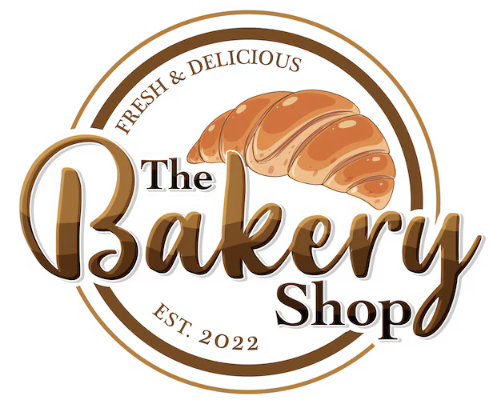

# The Bakery Shop — Sales Dashboard



A mobile-friendly sales dashboard for The Bakery Shop. It shows how much the shop has sold, what is selling, and what is running out, in a layout designed for one-handed use on a phone behind the counter. Built with plain HTML, CSS and JavaScript (no build step), so it can be hosted directly on GitHub Pages.

**Live site:** <https://macetenth.github.io/bakery-sales-dashboard/> (GitHub Pages, served from `main`)

> **Status: v1.** All numbers are generated sample data. There is no backend yet.

## Features

- **Period switcher:** Today, Week (last 7 days) and Month (last 30 days).
- **Hero total:** sales for the period with a % change against a comparison period, and a sparkline.
- **KPI tiles:** orders, average order value, items sold, and peak hour / best day, each with its change.
- **Sales chart:** sales by hour (Today) or by day (Week, Month), compared with yesterday, last week, previous period or last year. Tap or hover a bar for exact values; keyboard arrows also work. A table view is available.
- **Best sellers:** top 5 products with units sold, revenue and trend.
- **Sales by category:** donut chart with legend; tap a category to isolate it.
- **Running low:** products that are low or out of stock.
- **Responsive:** bottom navigation on phones, side rail on desktop. Buttons and tap targets are at least 56 px, icons at least 32 px.
- **Brand colours:** palette taken from the logo, plus a complementary teal. Chart colours are checked for colour-blind separation.

### Not built yet

Orders and More tabs, product detail, "See all products", Restock, and a custom date range. These show a "Coming in the next version" message.

## Run locally

```bash
python3 -m http.server 8765
```

Then open <http://localhost:8765>.

## Files

| File | Purpose |
|------|---------|
| `index.html` | Page structure and icon sprite |
| `style.css` | Brand tokens, layout, components |
| `app.js` | Sample data, charts, interactions |
| `assets/` | Logo (`logo.png`, `logo.avif`) |
| `spec.md` | Full design spec |
| `practice.md` | Working rules for this project |

See [spec.md](spec.md) for the full design.
